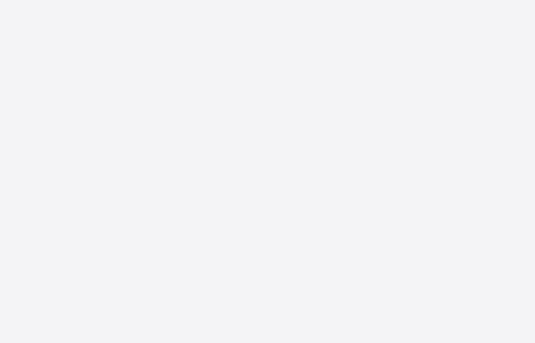
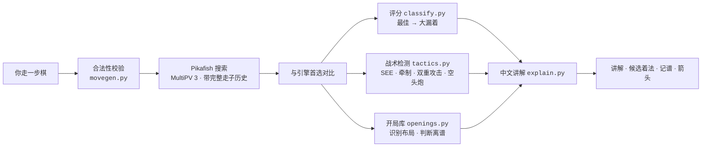
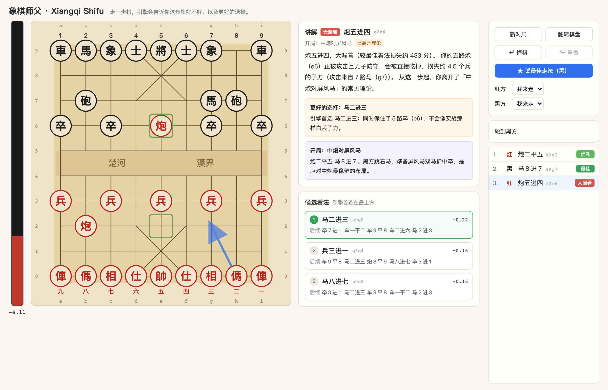
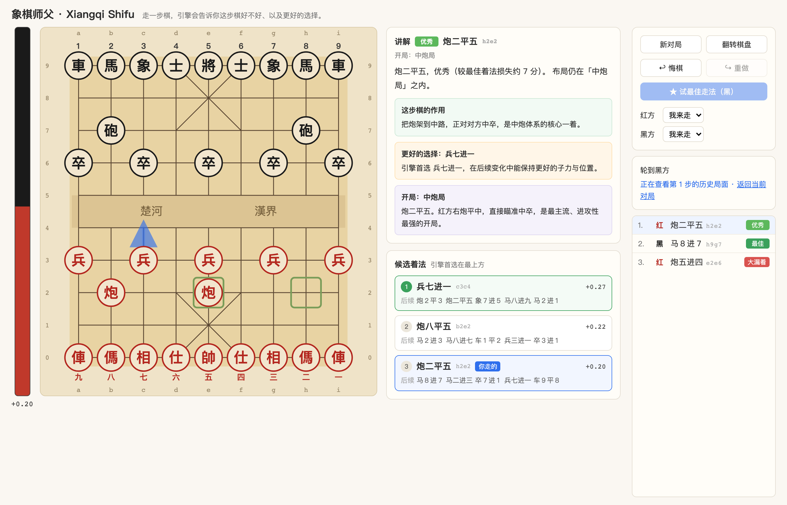

<div align="center">

# 象棋师父 · Xiangqi Shifu

**A Chinese Chess coach that tells you why your move was wrong — in Chinese, in real chess terms.**

Play a move. Get a verdict, an explanation, and the three moves the engine preferred.

[](backend/)
[](frontend/)
[](https://github.com/official-pikafish/Pikafish)
[](backend/tests/)
[](LICENSE)



<sub>炮二平五 → 马８进７ → **炮五进四**? hangs the cannon → `大漏着`, eval crashes to −4.11 → **悔棋** takes it back → **★ 试最佳走法** plays 马二进三 instead.</sub>

</div>

---

## The idea

Engines will tell you a move lost 433 centipawns. They won't tell you **which piece you just hung, to what, or what you should have played instead.** That gap is where improvement actually happens — so this fills it.

Every move gets run through a Pikafish search *and* a set of deterministic tactic detectors, then written up in 中文记谱法 the way a coach would say it:

> **炮五进四** · `大漏着` （较最佳着法损失约 433 分）
>
> 你的**五路炮（e6）**正被攻击且无子防守，会被直接吃掉，损失约 **4.5 个兵**的子力（攻击来自 **７路马（g7）**）。
>
> **更好的选择：马二进三** — 同时保住了５路卒（e6），不会像实战那样白丢子力。

Not a centipawn number. The piece, the attacker, the cost, and the alternative.

**No LLM is involved in the analysis.** Every claim above is derived from the board — static exchange evaluation, attack maps, a curated opening book. It is reproducible and it cannot hallucinate a threat that isn't there.

## How a move is judged



## What makes it a coach, not an eval bar

### 中文记谱法 throughout

Moves are written the way Xiangqi is actually read and taught — 炮二平五, 马八进七, 前车进一 — with the coordinate kept as small secondary text. Each side counts files from **its own right**:

| | 记谱数字 | 映射 | 例 |
|---|---|---|---|
| 红 | 一 二 三 四 五 六 七 八 九 | `file = 9 − col` | `h2e2` → **炮二平五** |
| 黑 | １ ２ ３ ４ ５ ６ ７ ８ ９ | `file = col + 1` | `h9g7` → **马８进７** |

The board edges carry both systems — `a`–`i` / `0`–`9` on the outside, each side's 记谱 numerals along its own edge — so 「威胁 h9」 and 「炮二平五」 can each be located at a glance. Both follow 翻转棋盘.

### It stays quiet when nothing is wrong

The naive version of "is this piece hanging?" flags every attacked, undefended piece — which means ordinary pawn tension like 兵七进一 facing 卒７进１ gets reported as a blunder-in-waiting on nearly every move. For an experienced player that noise is worse than silence.

Captures are judged with a real **static exchange evaluation** — x-ray aware, and verifying the attacker can *legally* capture (a pinned attacker threatens nothing). Only exchanges that actually lose material by a meaningful margin are reported. 牵制 likewise distinguishes a genuine pin from a mere 白脸将 constraint.

### The alternatives, with their plans

| | |
|---|---|
| **候选着法** | The engine's top 3, each with its score, 记谱 name, and the follow-up line — not a single "better move" arrow |
| **这步棋的作用** | What a *good* move achieved — 出动大子, 活通车路, 兵过河, 架中炮 — so 最佳 comes with a reason instead of a shrug |
| **更好的选择** | Why the engine's pick beats yours, grounded in what it defends or wins |
| **开局** | Names the opening you're in, and flags leaving theory **once**, on the ply it happens |



<sub>The same 炮五进四 blunder at full size — verdict, the hung piece and its attacker, the better move, and all three candidates with their follow-up plans.</sub>

### 悔棋 that actually works

悔棋 steps back to **your own** turn — in a game against the engine that means two plies, past the engine's reply — and disarms the engine so it can't instantly replay the move you just took back. It re-arms only on a deliberate act: playing a move, pressing **★ 试最佳走法**, or changing a side's controller.

Clicking any row in the move list reviews that position read-only. Browsing is purely client-side, so the live game is untouched and the engine can never interrupt you mid-read.



## Rules coverage

Implemented: the **flying-general** (白脸将) restriction · **困毙** (stalemate) as a **loss**, not a draw · **长将判负** (perpetual check loses) · repetition draw. The full move history is sent to Pikafish with every position, so the engine sees repetitions too.

> [!NOTE]
> **长捉 and 长兑 are deliberately not implemented.** Judging perpetual chasing correctly requires rulings on whether a chased piece counts as protected and whether a chase is a genuine threat — a thicket of special cases where a naive version would confidently return wrong verdicts. Games that repeat without perpetual check report `draw_repetition` (和棋) instead.

## Quick start

**1 · Engine** — Pikafish is GPL-3.0 and is *not* bundled; the script fetches it.

```bash
brew install p7zip            # or: apt install p7zip-full
./scripts/setup_engine.sh     # → engine/pikafish + engine/pikafish.nnue
```

Auto-detects macOS Apple Silicon and generic Linux/AVX2. For anything else, grab a build from the [Pikafish releases](https://github.com/official-pikafish/Pikafish/releases) and drop the binary at `engine/pikafish` (executable) with `pikafish.nnue` beside it.

**2 · Backend**

```bash
cd backend
python3 -m venv .venv && source .venv/bin/activate
pip install -r requirements.txt
pytest -q                                   # 141 passing (engine tests skip if the binary is absent)
uvicorn app.main:app --host 127.0.0.1 --port 8000
```

**3 · Frontend**

```bash
cd frontend
npm install
npm run dev                                 # → http://localhost:5173
```

Optional env: `VITE_API_BASE_URL` (frontend) · `ENGINE_PATH`, `ENGINE_DEPTH` (default `14`), `ENGINE_MULTIPV` (default `3`) (backend).

## Layout

```
backend/     FastAPI · board & move generation · 中文记谱法 · repetition rules
             UCI engine client · SEE tactic detectors · opening book · REST API
frontend/    Vite + React + TypeScript · SVG board, pieces as styled characters
engine/      Pikafish binary + NNUE weights  (downloaded, git-ignored)
scripts/     setup_engine.sh
docs/        api-contract.md — the REST contract the frontend is built against
```

The whole UI is one non-scrolling screen: the board is the only element that absorbs slack, sizing itself from whatever the panels don't claim, so 讲解 is always beside the position it describes.

## Testing

```bash
cd backend && pytest -q          # 141 tests
cd frontend && npx tsc --noEmit && npm run build && npx oxlint .
```

Notation gets the heaviest coverage — every opening-book line is replayed and re-rendered, with a decoder for genuine round-trips and a uniqueness assertion over every legal move in several positions. Engine-backed tests run against the real binary and skip cleanly without it.

## Scope

Play & live review only — no PGN import or batch game review yet. The engine always plays at full strength; either side can be handed to it or played by you. All analysis — classification, tactic detection, notation, opening lookup, repetition judging — is deterministic and rule-based.

## Credits

Engine: [**Pikafish**](https://github.com/official-pikafish/Pikafish) (GPL-3.0), a Stockfish-derived NNUE engine for Xiangqi, run as a separate process over UCI and downloaded at setup rather than distributed here. This project's own code is MIT — see [LICENSE](LICENSE).
